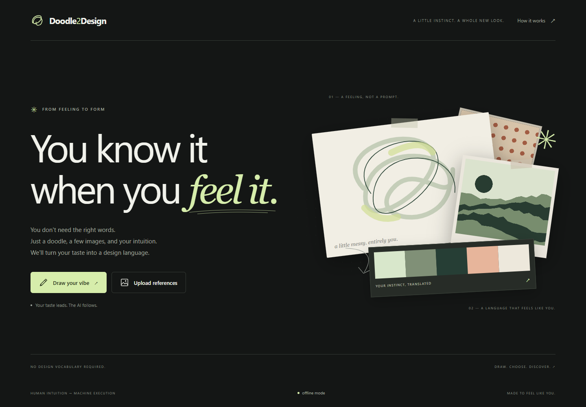
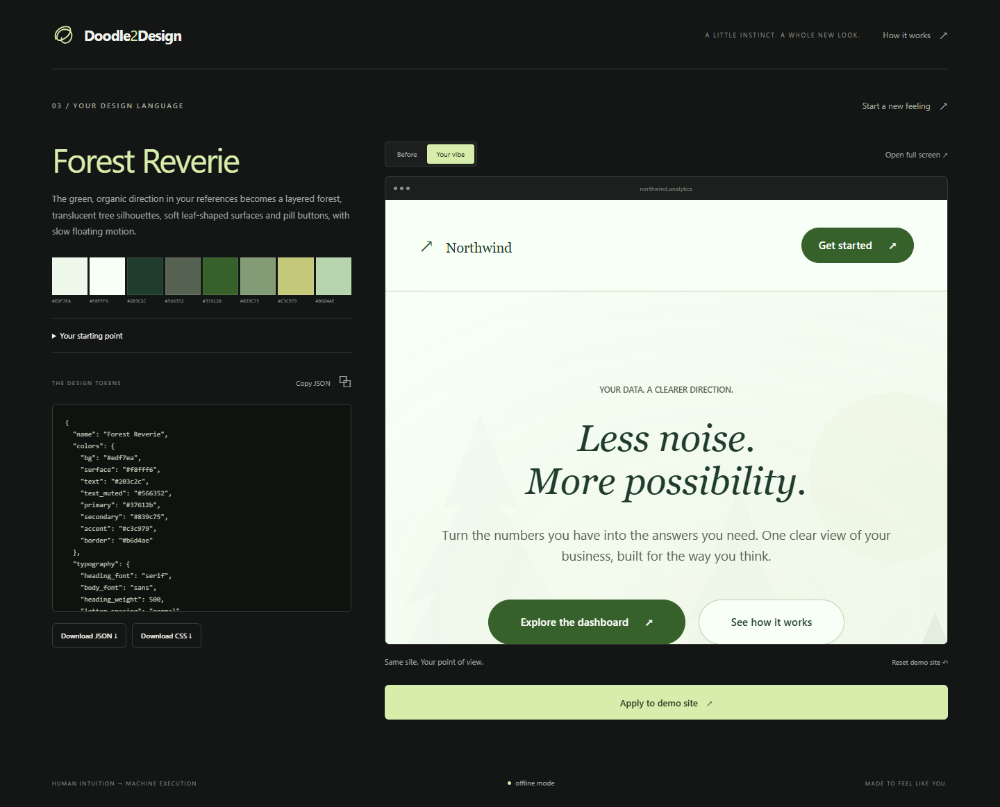

# Doodle2Design

**Your instinct. A design language.**

AI can write code and layouts, but it cannot know your taste. And most of us cannot describe an aesthetic with “modern and cool.” Doodle2Design translates human intuition into machine execution: draw a feeling or upload a few visual references, follow your eye through ten image comparisons, then watch your choices become a complete visual redesign for a real demonstration website.

The human supplies the direction. The AI executes the styling.



## Quick start

Install Python **3.10 or newer**, clone this repository, then run from its directory:

```sh
python start.py
```

On macOS/Linux you can also use `./run.sh`; on Windows, double-click `run.bat`.

The launcher creates `.venv`, installs requirements, creates `.env`, indexes your images (or generates 100 original procedural references), starts FastAPI at **http://localhost:8000**, and opens your browser. If 8000 is occupied it tries **8001**. Press **Ctrl+C** in the terminal to stop. Run again to restart: installation is skipped when the requirements hash matches `.venv/.installed`.

The first installation needs internet access for Python packages. After installation, offline mode uses no external network services. No Node.js, npm, frontend build, database, authentication or hosting is required. Keep the server bound to loopback; this app is designed for a personal local demo.

## Use it

1. **Draw your vibe:** use the brush, eraser, rectangle, circle or line tool. Pick a color, choose from eight swatches, change the background, adjust brush size (2–40 px), undo up to 20 changes, or clear. Mouse, pen and touch are supported. Ctrl/Cmd+Z undoes while drawing. Choose **Done**.
2. Or **Upload references:** drop or choose **1–3 PNG, JPG or WebP** images, each at most **8 MB** and **25 megapixels**. Remove thumbnails to change your selection, then continue.
3. **Follow your eye:** choose one of two images for **10 rounds**, with no visible text. Click/tap or use **← / →**. Portrait screens stack the images. Each round uses the same category for both images, and no image repeats.
4. **See your design language:** review the palette, rationale, baseline and validated JSON, copy/download tokens, export CSS, and compare the live demo **Before / Your vibe**. **Apply to demo site** republishes your session's cached theme locally. **Reset demo site** removes the saved theme and shows defaults; your result remains available to reapply. **Start a new feeling** clears the session and returns to the beginning.

Themes now change illustration, composition, surface treatment and motion as well as typography and colors:

| Direction | Graphics and composition | Shapes and movement |
| --- | --- | --- |
| Botanical | Layered translucent trees, hills, green palette, centered hero | Leaf-shaped cards, pill controls, slow floating and swaying |
| Cosmic | Orbital illustration, star field, luminous glass panels | Soft buttons, drifting rings, animated chart bars |
| Architectural | Building blocks, grid backdrop, reversed poster composition | Clipped corners, strong outlines, numbered cards, crisp entrances |
| Editorial | Paper-cut waves and flowers, illustration-first composition | Sculpted paper cards, pill buttons, gentle movement |

Use **Pause motion** on the demo to stop ambient animations. The operating system's reduced-motion setting disables motion and ensures all content stays visible. The neutral wizard and text-free A/B phase stay consistent so theme styling does not bias your choices.



## Optional vision model

Edit the automatically created `.env` (or copy `.env.example` to `.env`):

```dotenv
ANTHROPIC_API_KEY=your-key-here
VLM_MODEL=claude-sonnet-4-6
VIBE_MOCK=0
```

Restart the server after changing environment settings. An existing environment variable takes precedence over `.env`.

With a key, the **Anthropic Messages API** analyzes your baseline, plans comparisons when images have no tags, then extracts tokens using the original input, ten winning images and textual descriptions of ten rejections. Image content is normalized to JPEG quality 80, at most 768 pixels on the longest side. Images are sent to Anthropic **only when this integration is enabled**; your key stays on the backend.

The SDK has automatic retries disabled so the app owns the exact two-attempt budget. Each attempt has a 30-second limit; malformed JSON (including fenced JSON) and invalid schemas receive one retry. Final extraction has a stricter **14-second overall model deadline**, then returns an offline theme, keeping the last-click transition bounded. Actual model latency and the under-15-second real-model target require a working key and service availability; live paid calls were not performed during implementation.

## Offline / Mock Mode

No API key, `VIBE_MOCK=1`, or an exhausted model call enables the deterministic fallback. This is real image analysis, not a fixed canned theme:

- Pillow measures average brightness, color saturation, edge density and a quantized five-color palette.
- The baseline chooses which categories to probe first.
- Pairing uses a session-seeded RNG within categories, or minimizes overlapping tags when available.
- Extraction combines the original input palette (weighted as an anchor) with winning references to select colors, typography, geometry, effects and a coherent visual direction. Green/organic references select a forest scene with soft controls; cool dark references can select orbital graphics; structured neutral references select an architectural direction; warmer softer references select paper-cut waves.
- Text/background contrast is corrected to **at least 4.5:1** by changing only `colors.text` when necessary.

A discreet **offline mode** footer badge appears outside calibration. No labels, badge, toast or navigation appear during the A/B phase. If an image/choice request fails there, the circular **↻** control retries the same round without counting a duplicate vote.

## Add your own reference library

The included 100 references are **original procedural placeholders**, not photographs or a curated final photography collection. Replace or supplement them with your own images in:

```text
images/library/
  architecture/  # concrete, glass, classical, wood, interiors, neon
  landscapes/    # forests, desert, snow, beaches, cities, fields
  textures/      # paper, concrete, metal, fabric, marble, grain
  patterns/      # checkers, organic lines, dots, grids, floral
```

Aim for **25 per category**, with clear aesthetic contrasts; **at least 6 distinct images per category** are needed for a ten-round plan. Duplicate visual content is excluded when the library loads, even under different filenames or image dimensions. PNG, JPG/JPEG and WebP are supported. Rebuild with the virtual environment Python:

```sh
# macOS / Linux
.venv/bin/python scripts/build_manifest.py

# Windows
.venv\Scripts\python scripts\build_manifest.py
```

Restart the server afterward. The manifest is generated automatically when missing; the launcher rebuilds it on every start. `scripts/fetch_sample_images.py` generates placeholders only if the entire library is empty. It never overwrites supplied references. Existing optional `tags` are retained by path when rebuilding.

```json
{"images":[{"id":"landscapes_001","category":"landscapes","path":"images/library/landscapes/redwood_mist.jpg","tags":[]}]}
```

All four categories appear at least twice (3, 3, 2, 2). The model's pair plans are validated for exact category order, valid ids, no repeats and same-category pairs. The plan is cached per session and left/right positions are randomized. Optional automatic VLM pre-tagging and mid-session adaptive re-planning are not part of this MVP.

## Architecture

```text
python start.py
      |
      +-- .venv + dependencies + library preparation
      |
      +-- uvicorn / FastAPI (127.0.0.1:8000 or 8001)
             |
             +-- /         vanilla HTML / CSS / JavaScript wizard
             |                  |
             +-- /api/     in-memory sessions + strict Pydantic models
             |                  |
             |            Pillow analysis <--> optional Anthropic VLM
             |                  |
             |            validated VibeTokens + contrast fix
             |                  |
             |            demo_site/vibe.json (latest only)
             |
             +-- /images/  local references + manifest
             |
             +-- /demo/    fixed Northwind Analytics HTML
                                |
                           token_map.js + visual_map.js
                                |
                           CSS variables + local SVG graphics
                                |
                           visuals.css + motion.js
                                ^
                           live iframe postMessage
```

Uploads stay in memory and are never saved to disk. Sessions are process-local, limited to 100, and idle entries are cleaned after two hours when another session is created. Restarting loses sessions; the latest theme stays in the ignored `demo_site/vibe.json` until reset. The demo intentionally has one latest theme shared by all local tabs. Only one uvicorn worker should be used.

## Token JSON contract

All original core keys are required; extra keys and invalid hex/enumerated values are rejected. New extraction also requires the complete `visuals` group. Older saved files that lack it still load with neutral graphics/motion defaults. Fonts use local system stacks; Google Fonts is never loaded.

```json
{
  "name": "Neon Brutalist",
  "colors": {
    "bg": "#0b0b10",
    "surface": "#15151d",
    "text": "#f2f2f7",
    "text_muted": "#9a9ab0",
    "primary": "#ff2e88",
    "secondary": "#00e5ff",
    "accent": "#ffd400",
    "border": "#2a2a38"
  },
  "typography": {
    "heading_font": "mono",
    "body_font": "sans",
    "heading_weight": 700,
    "letter_spacing": "tight",
    "scale": "compact"
  },
  "geometry": {"radius": "sharp", "border_width": "thick", "density": "tight"},
  "effects": {"shadow": "hard", "gradient": "subtle", "texture": "grain"},
  "visuals": {"motif": "grid", "layout": "poster", "motion": "kinetic", "button_style": "cut", "card_style": "outline"},
  "rationale": "Concrete references led to sharp corners and a strong, structured theme."
}
```

| Field | Allowed values |
| --- | --- |
| All eight colors | `#` followed by exactly six hex digits |
| heading_font | `serif`, `sans`, `mono`, `display` |
| body_font | `serif`, `sans`, `mono` |
| heading_weight | 100–900 in steps of 100 |
| letter_spacing | `tight`, `normal`, `wide` |
| scale | `compact`, `normal`, `spacious` |
| radius | `sharp`, `soft`, `round`, `pill` |
| border_width | `none`, `thin`, `thick` |
| density | `tight`, `normal`, `airy` |
| shadow | `flat`, `soft`, `hard`, `neumorphic`, `glow` |
| gradient | `none`, `subtle`, `bold` |
| texture | `none`, `grain` |
| visuals.motif | `none`, `forest`, `orbital`, `grid`, `waves` |
| visuals.layout | `split`, `centered`, `poster` |
| visuals.motion | `none`, `calm`, `kinetic` |
| visuals.button_style | `token` (use geometry radius), `pill`, `soft`, `cut`, `sharp` |
| visuals.card_style | `solid`, `glass`, `organic`, `outline`, `paper` |

The backend schema is in `backend/schemas.py`. The token-to-CSS mapping is centralized in `demo_site/token_map.js` and `visual_map.js`, used by live application and CSS export. `graphics.js` contains original SVG scenes, deterministically recolored from the validated palette. The demo supports its specified navbar, hero, six feature cards, dashboard with three stats/a chart/five table rows, three pricing cards, a local-only form and footer.

## How it works

The model never generates code. It selects colors, typography, graphics, composition, motion and shapes from a fixed vocabulary. Pydantic validates those choices, then deterministic code maps them onto CSS variables, vector illustrations and predefined responsive compositions. The content and HTML structure stay the same while the whole presentation changes. The iframe only accepts same-origin messages from its parent and validates the mapping again. Exported `theme.css` includes the same graphic data URIs, layout, button/card and motion variables; use it with the supplied Northwind HTML, `styles.css`, `visuals.css` and motion script.

## API

Machine-readable API schema: [localhost:8000/openapi.json](http://localhost:8000/openapi.json). CDN-dependent Swagger/Redoc pages are disabled so the application remains self-contained offline.

| Method | Route | Behavior |
| --- | --- | --- |
| GET | `/healthz` | `{ "ok": true }` |
| GET | `/api/config` | Offline-mode status without exposing credentials |
| POST | `/api/session` | Create a UUID session |
| POST | `/api/baseline` | Multipart `session_id`, `mode`, and 1–3 `files` (draw: exactly 1) |
| GET | `/api/ab/next?session_id=…` | Current pair, or `{ "done": true }` |
| GET | `/api/ab/next?session_id=…&prefetch=true` | Preview the following pair without advancing |
| POST | `/api/ab/choice` | JSON `session_id`, `round`, `winner_id`, `loser_id`; identical retries are idempotent |
| POST | `/api/extract` | JSON `session_id`; validated tokens, baseline and `degraded` flag; caches and saves theme |
| GET | `/api/tokens` | Latest saved tokens, or 404 |
| POST | `/api/reset` | JSON `session_id`; clear session and saved theme. Optional `demo_only: true` preserves session for reapplication |

Sessions serialize mutation with an asyncio lock. Out-of-order or fabricated choices receive 409; unknown sessions receive 404; bad input receives 422; oversized uploads receive 413. API responses are not browser-cached. CORS is permissive as specified; no cookies, auth or database are used.

## Tests

```sh
# macOS / Linux
.venv/bin/python -m pytest -q

# Windows
.venv\Scripts\python -m pytest -q
```

Tests force offline mode and do not call a paid API. They cover token schemas, invalid fields, contrast correction, image preparation, distinct palettes, ten-round selection invariants, full draw/upload API flows, upload restrictions, duplicate vote safety, phase guards, reset/reapply, JSON fence parsing, model retry and fallback.

Optional mapping tests use Node's built-in runner, with no npm install: `node --test tests/test_visual_map.mjs`. Node is not needed to run the app or its Python suite. These tests cover legacy themes, complete forest mapping, motion-off behavior, graphic color safety, enum rejection and readable primary-button text.

Browser verification exercises both input paths, canvas drawing/undo/shapes, all ten rounds by keyboard and click, before/after, CSS download, reset/reapply, and layouts at 320/768/1024/1440 px. See [docs/VERIFICATION.md](docs/VERIFICATION.md) for the final results and limits.

## Decisions and scope

- The supplied document calls the app “Vibe”; the user's naming correction makes it **Doodle2Design**. Specified internal API/type/env names remain compatible.
- Procedural images keep a fresh checkout self-contained; a real photo library can be dropped in later.
- No auto-tagging or adaptive mid-session re-planning was added. Before/after preview and JSON/CSS exports are included.
- The later visual-redesign request expands the original spec with constrained graphics, motion, composition and surface tokens. See [docs/EXPRESSIVE_THEMES.md](docs/EXPRESSIVE_THEMES.md).
- No key is required. Live Anthropic behavior is implemented against the [official Python SDK docs](https://platform.claude.com/docs/en/api/sdks/python) and [Messages API](https://platform.claude.com/docs/en/build-with-claude/working-with-messages). FastAPI uploads use its [documented UploadFile interface](https://fastapi.tiangolo.com/tutorial/request-files/).
- Northwind is fictional; its links navigate within the demo and its contact form only displays a local confirmation. It sends nothing.

MIT licensed. See [LICENSE](LICENSE).
