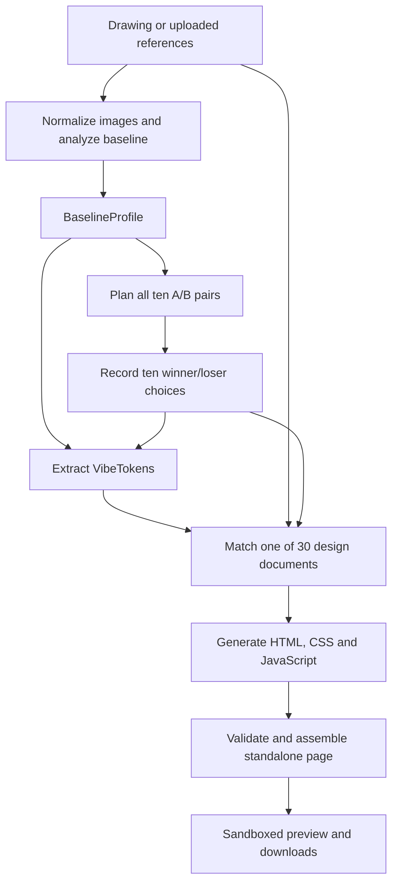

# Doodle2Design

🏆 **2nd place (Main Track)** at the **"Build Something AI Cannot Do Alone @ Cal"** hackathon.
Hosted by **DiversaTech** and sponsored by **Google**, **Fountain Ventures**, and **Glasser**.

**Your instinct. A design language.**

Draw a feeling or upload visual references, follow your eye through ten A/B
comparisons, and let an LLM turn that taste into a completely redesigned website.

[Quick start](#quick-start) · [How it works](#how-it-works) ·
[Architecture](#architecture-and-isolation) · [API](#api) · [Verification](#verification)

## Quick start

Install Python **3.10 or newer**, clone this repository, then run:

```sh
python start.py
```

On Windows you can double-click run.bat; macOS/Linux users can run ./run.sh.
The launcher creates .venv, installs requirements, creates .env, indexes the bundled 50 real
photographs with AI-authored visual annotations, and opens [localhost:8000](http://localhost:8000).
It tries port 8001 if 8000 is occupied. Ctrl+C stops the server.

No frontend build, npm, database, authentication or hosting is required.
Use one server worker bound to loopback; this is a personal local application.

## Enable LLM website generation

Set your OpenAI key in the local, Git-ignored .env file:

```dotenv
AI_PROVIDER=openai
OPENAI_API_KEY=your-key-here
OPENAI_MODEL=gpt-5.4
OPENAI_VISION_MODEL=
OPENAI_REDESIGN_MODEL=
VIBE_MOCK=0
```

Restart the server after changes. Existing environment variables take precedence.
OPENAI_MODEL is the default for all OpenAI calls. OPENAI_VISION_MODEL and
OPENAI_REDESIGN_MODEL optionally override analysis and redesign respectively.
The key remains on the backend and is never returned by the API or UI.

Anthropic remains supported with AI_PROVIDER=anthropic, ANTHROPIC_API_KEY,
VLM_MODEL and optional REDESIGN_MODEL. AI_PROVIDER=auto prefers OpenAI if its
key is present, otherwise Anthropic. Explicit selection never falls back to the
other provider. Leave VIBE_MOCK=0 to enable AI; VIBE_MOCK=1 disables both.

Without a key, drawing, uploads, ten comparisons and taste extraction work offline.
Website generation shows a setup message; it does not substitute a preset.
Configure the key before starting a calibration because restarting clears sessions.

With AI enabled, normalized source images and winning references are sent to
the selected provider for visual analysis, theme matching and code generation. Matching also
uses descriptions of rejected references. The selected full design brief and
original demo content are sent for generation.

## Use it

1. **Express your taste.** Draw with brush, shapes and color, or upload 1–3
   PNG/JPG/WebP references (8 MB and 25 megapixels maximum per image).
2. **Follow your eye.** Choose between two distinct images in each of ten
   text-free rounds. Click, tap or use the left/right arrow keys.
3. **Match a theme.** The LLM considers your baseline, mood, sentiment, shapes,
   texture, palette and accepted/rejected preferences to select one of the exact
   30 document titles from the supplied design catalog.
4. **Generate the website.** The LLM follows that theme's full brief to write new
   HTML, CSS and JavaScript: layout, hierarchy, graphics, button shapes, surfaces,
   animations and local interactions. This can take several minutes.
5. **Inspect and save.** See the theme and match reason, compare the original and
   AI redesign, open the isolated preview full screen, or download the entire
   standalone HTML website and model-written CSS. JSON export preserves the
   extracted taste profile.

Before/after, showing the saved redesign and downloads reuse the completed
artifact. They do not trigger another paid generation. A failed job has an
explicit retry. Start a new feeling cancels active work and clears the session.

Generated pages include pause/resume motion and respect reduced-motion settings.
The contact form validates locally and shows a demo confirmation; it sends nothing.

## How it works



### Calibration and taste representation

Uploads are decoded with Pillow, checked for format and pixel limits, corrected
for EXIF orientation, composited onto white, and normalized to JPEG with a maximum
768-pixel edge. Normalized images are kept in session memory.

| Contract | Contents | Purpose |
| --- | --- | --- |
| `BaselineProfile` | Summary, visual attributes, dominant colors, mood words and preferred categories | Anchors calibration in the original input |
| `ABPair` / `Choice` | Round, category, image IDs and the chosen winner/loser | Records explicit preferences across ten rounds |
| `VibeTokens` | Name, colors, typography, geometry, effects, visual motifs/layout/motion and rationale | Provides validated taste evidence and supports the legacy renderer |
| `ExtractResponse` | Tokens, baseline and a `degraded` flag | Caches extraction and identifies offline fallback in the analysis pipeline |
| `ThemeMatch` | Exact catalog title and match reason | Selects the complete design brief for generation |
| `GeneratedDesign` | Summary, body HTML, CSS and JavaScript | Supplies the artifact assembled into the preview and HTML download |

These contracts are validated with Pydantic. The extracted token palette receives
a text/background contrast correction; this does not validate the contrast of the
subsequently generated website.

All ten comparison pairs are planned after baseline analysis. The baseline's
preferred categories determine their order; each of the five categories appears
twice, and no photo repeats. With the bundled, fully tagged library, selection is
local: a session-seeded shuffle breaks ties, and each pair minimizes shared tags
among the remaining tagged photos in its category. Left/right placement is also
seeded. Choices do not change later pairs. If library tags are incomplete, the app
can request a model plan, validate it, and fall back to the local planner.

Baseline analysis and taste extraction use the configured vision model when
available. Offline inference derives a palette and visual direction from image
statistics such as brightness, saturation and edges. Extraction combines the
original input with all ten winners; online extraction also receives winner and
loser annotations. Offline extraction weights source images three times alongside
the winners, with the first choice contributing to its explanation. It is a
heuristic, not a trained preference model.

### Theme matching and website generation

Matching receives normalized source images, all ten winning photos, the baseline,
tokens, selected/rejected tags and summaries of all 30 design documents. It must
return an exact catalog title. Generation receives the same visual evidence,
the selected full brief, match reason and original Northwind demo HTML.

The model writes a new page using vanilla HTML, CSS, JavaScript and inline SVG.
The taste tokens inform that design without constraining it to the legacy token
renderer's layouts or motifs. Calibration can fall back offline; matching and
generation require a configured provider and never replace a failed generation
with a preset.

## Real-photo reference dataset

The A/B library contains **50 real Unsplash photographs**, ten each in scenery,
architecture, objects, animals and photographed patterns/textures. All annotations
were authored by Codex using vision, with **no human review**. Observed colors,
shapes, textures and composition are separate from subjective mood words and
suggested design treatments.

Browse [the gallery](images/gallery.html), [JSON](images/dataset.json),
[CSV](images/dataset.csv), and [dataset notes and licenses](images/README.md).
Photographer credits, source URLs and file hashes are included for every photo.
The five categories each appear twice across ten rounds, with no repeated photo.

Normal startup uses the bundled local files. To restore missing photos and rebuild:

```sh
python scripts/download_photo_dataset.py
python scripts/build_manifest.py
```

The downloader checks hashes and never generates placeholders. Rebuilding preserves
complete annotations and provenance from `images/dataset.json`. Custom images can
be added under the architecture, landscapes, objects, animals and patterns folders
in `images/library/`; keep at least six distinct images per category. Restart the
server after rebuilding. Photos retain the Unsplash License rather than the
repository's MIT software license.

## Your design documents

The supplied archive contains 30 **Word documents**, despite the original PDF
description. Original files and their complete extracted design-system sections
are stored in [design_prompts](design_prompts/README.md).

Theme names exactly match filenames: Academia, Art Deco, Bauhaus, Botanical,
Bold Typography, Claymorphism, Cyberpunk, Enterprise, Flat Design, Industrial,
Kinetic, Luxury, Material Design, Maximalism, Minimal Dark, Modern Dark,
Monochrome, Neo Brutalism, Neumorphism, Newsprint, Organic, Playful Geometric,
Professional, Retro, SaaS, Sketch, Swiss Minimalist, Terminal, Vaporwave and Web3.

The common agent-role preamble is excluded. Documents provide visual requirements,
not tool commands or permissions. Selection uses catalog excerpts; generation
receives the selected complete design brief. Framework examples and web-font
suggestions are adapted to vanilla browser code, inline SVG/CSS and system fonts.

Reimport a revised archive with:

```sh
python scripts/import_design_prompts.py "path/to/Design Prompts.zip"
```

Restart after importing so the cached catalog reloads.

## Architecture and isolation

The app uses FastAPI, in-memory UUID sessions, Pillow, Pydantic, vanilla JavaScript
and the OpenAI/Anthropic async SDKs. Calibration requests populate a session;
an asynchronous background task handles matching and generation. The browser
polls job status while the UI remains responsive.

| Module | Responsibility |
| --- | --- |
| `start.py`, `run.bat`, `run.sh` | Local environment setup and server launch |
| `frontend/` | Drawing/upload flow, comparison rounds, status polling and result controls |
| `backend/main.py` | FastAPI application, calibration routes, static files and host response headers |
| `backend/session.py` | Process-local session state, per-session locks, cleanup and cancellation |
| `backend/imaging.py`, `backend/schemas.py` | Image normalization, typed contracts and token contrast correction |
| `backend/image_db.py`, `backend/selection.py` | Reference index and ten-round comparison planning |
| `backend/vlm.py`, `backend/prompts.py` | Baseline analysis, optional model planning and taste extraction |
| `backend/mock.py`, `backend/design_direction.py` | Image-derived offline analysis and token directions |
| `backend/ai_provider.py` | Provider/model selection and OpenAI request handling |
| `backend/redesign.py` | Catalog loading, matching, generation, validation, job lifecycle and artifact routes |
| `design_prompts/`, `images/` | Design catalog/briefs and annotated photo dataset |
| `demo_site/` | Original Northwind content and legacy token renderer |
| `tests/` | Offline API/model-contract tests and browser fixtures |

### Generated-code boundary

Generated code is never executed on the server or inserted into the host DOM.
A sandboxed iframe and an HTTP content security policy isolate it from the app:
no host DOM access, storage, network connections, external scripts/resources,
nested frames or form submissions. Local scripts, animations and form handlers
work. Exported HTML includes its own restrictive resource policy.

The preview uses both an iframe sandbox and an HTTP CSP sandbox with
`allow-scripts allow-forms`, without `allow-same-origin`. Its opaque origin blocks
access to the host's DOM and storage. `form-action 'none'` blocks submissions
while allowing local form handlers. The downloaded HTML embeds a resource CSP;
it runs outside the app's iframe and does not carry the preview's HTTP sandbox.

Validation rejects extra response fields, invalid field types/lengths, forbidden
document/resource tags in body markup, and closing-tag breakouts in CSS or JS.
It requires section IDs (`features`, `dashboard`, `pricing`, `contact`,
`contact-form`), selected semantic tags, and literal occurrences of Northwind's
name, key metrics and prices. These are structural and string checks: they do
not prove values are visible, all source content is preserved, interactions work,
or accessibility and visual quality meet the prompt. The sandbox and CSP enforce
the preview boundary; validation is not a general JavaScript safety proof.

The trusted original Northwind demo remains under /demo/ for comparison.
The earlier token renderer is retained for compatibility, but is no longer the
result page's redesign engine. Its fixed visual vocabulary is taste evidence,
not a limit on the generated website.

### State, concurrency and failures

Sessions are process-local and limited to 100. Creating a new session removes
sessions idle for more than two hours, excluding locked sessions and active
generation jobs. Cleanup is triggered by session creation, not a periodic timer.
Reset cancels generation and discards the artifact. Restart loses sessions and
generated pages; download HTML to keep a design. Uploads stay in memory.
The legacy latest-token file demo_site/vibe.json remains ignored by Git.

At most four generation jobs may be active in total, including queued and running
jobs; a semaphore permits two to execute concurrently. Each redesign model stage
allows at most two attempts, including invalid output, with a 210-second limit
per attempt. The total job budget is eight minutes, including queue time.
Selection and generation failures produce retryable errors.
The original taste extraction retains its 14-second model deadline and offline
fallback.

Job phases are `idle → queued → matching → generating → ready`, with `error`
on failure. Repeated start requests reuse queued, running or completed work;
starting again after an error retries the job. Reset cancels the task and clears
its state, and server shutdown cancels active tasks. Per-session locks serialize
calibration mutations. No durable queue, database or cross-worker coordination
is used, which is why the app runs with one server worker.

See [LLM_REDESIGN.md](docs/LLM_REDESIGN.md) for contracts, lifecycle and boundaries.

## API

[OpenAPI schema](http://localhost:8000/openapi.json) is available locally.

| Method | Route | Behavior |
| --- | --- | --- |
| POST | /api/session | Create session |
| POST | /api/baseline | Multipart session_id, mode, files |
| GET | /api/ab/next | Current pair; optional prefetch=true |
| POST | /api/ab/choice | Validated, idempotent choice |
| POST | /api/extract | Extract and cache taste profile |
| POST | /api/redesign | Start/reuse document-led generation |
| GET | /api/redesign | Poll phase, theme, match reason and output links |
| GET | /api/redesign/preview | Isolated generated HTML |
| GET | /api/redesign/download | Standalone HTML attachment |
| GET | /api/redesign/css | Model-written CSS attachment |
| POST | /api/reset | Cancel and clear session; demo_only retains session |
| GET | /api/config | Offline/generation availability and catalog size |
| GET | /api/tokens | Legacy latest saved taste tokens |

Session-specific GET endpoints use session_id query parameters. Mutation requests
use JSON session_id unless noted. Invalid phases return 409, unknown sessions 404,
invalid inputs 422, oversized uploads 413, missing generation configuration 503,
and a full job queue 429. Session capacity exhaustion also returns 503.

## Verification

Run .venv/Scripts/python -m pytest -q on Windows, or
.venv/bin/python -m pytest -q on macOS/Linux. The suite never calls a paid model.

Optional legacy mapping tests: node --test tests/test_visual_map.mjs.
Optional Edge browser QA requires Playwright and the normal server on port 8000:
start python tests/redesign_fixture_server.py on port 8002, then run
node tests/browser_redesign.cjs.
The fixture substitutes model responses while exercising the real backend and UI.

See [VERIFICATION.md](docs/VERIFICATION.md) for results and limitations.
A working API key is required to assess actual model output and generation latency;
local fixture tests verify integration, not live model design quality.

MIT licensed. See [LICENSE](LICENSE).
